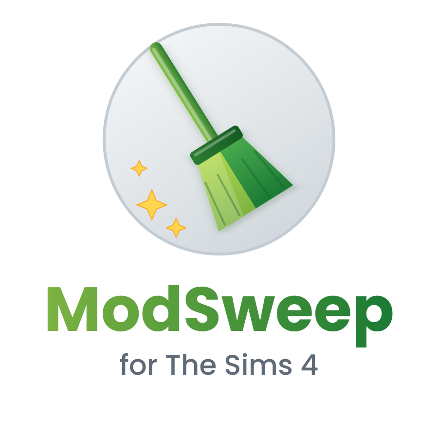

# ModSweep for The Sims 4

**Clean up your Mods folder in minutes: find duplicates, old versions, junk files and misplaced mods.**

Big Mods folders get messy fast. Duplicate downloads, three versions of the same mod, forgotten ZIP files, preview images and script mods sitting one folder too deep. ModSweep finds all of that for you and lets you clean it up with a few clicks.

Everything you delete goes to the **Recycle Bin** (Trash on Mac and Linux), so nothing is lost by accident.

## Features

**8 search types**

* **Duplicate files (same content):** finds identical mods, even if they have different names
* **Duplicate file names:** same name in different folders
* **Several versions of the same mod:** e.g. `Mod_v4.1` and `Mod_v4.2` or `Mod (1)`
* **All files of a type:** e.g. `.png`, `.mp4` or any other type you enter
* **Unneeded files:** archives, readmes, preview images, empty files, Thumbs.db
* **Empty folders**
* **Largest files:** see what takes up the most space
* **Misplaced mods:** script mods deeper than 1 subfolder and packages deeper than 5 subfolders, which the game does not load

**Tools**

* **Mark (keep newest):** marks all duplicates except the newest file of each group
* **Move marked to correct folder:** moves misplaced mods up to the deepest allowed level with one click
* **Clear Sims cache:** deletes localthumbcache.package and the cache folders
* **Check update status online:** opens Scarlet's Mod List (you choose the SFW or SFW + NSFW edition)
* **Save list (Excel):** export any result list as a table
* **Show in Explorer**, sorting by name, folder, size or date

**6 languages:** English, German, Spanish, French, Polish and Portuguese (Brazil)

## Download

Get the latest version on the **[Releases page](https://github.com/justin-wq1337/ModSweep/releases/latest)**:

* **ModSweep-for-The-Sims-4.zip** for **Windows 10 and 11**. Nothing else to install.
* **ModSweep-for-The-Sims-4-Mac-Linux.zip** for **macOS 11 or newer** and **Linux**. Needs Python 3 (free from python.org on Mac).

## Installation (Windows)

1. Extract the ZIP into its own folder, e.g. `Documents\ModSweep`.
   **Do not put it inside your Mods folder.**
2. Double click **Start.bat**.
3. Optional: double click **Create Desktop Shortcut.bat** to get a desktop shortcut with the ModSweep logo.

If Windows shows "Windows protected your PC", click **More info** and then **Run anyway**.
If nothing happens, start **Start (Troubleshooting).bat** to see error messages.

## Installation (Mac and Linux)

Please follow the README.txt inside the Mac and Linux ZIP. In short:

* **Mac:** install Python from python.org. The first time, macOS blocks the starter: on macOS 15 or newer allow it in **System Settings > Privacy & Security > Open Anyway**, on older versions right click **Start ModSweep (Mac).command** and choose **Open**.
* **Linux:** install Tkinter if needed (e.g. `sudo apt install python3-tk`), then run `./start-modsweep-linux.sh`.

## Safety and transparency

* ModSweep is **open source**. `ModSweep.ps1` (Windows) and `modsweep.py` (Mac and Linux) are plain text, so you can read every line.
* It does **not** collect or send any data. The only internet access is opening Scarlet's Mod List in your browser when you click that button.
* Deleted files go to the **Recycle Bin** or Trash. If Windows cannot use the Recycle Bin (for example on a network drive), Windows asks you before anything is deleted for good.
* Empty folders are checked again right before they are deleted, so nothing that was added in the meantime is lost.
* For duplicates and versions, ModSweep never lets you delete every file of a group.
* Some antivirus programs are suspicious of scripts in general. If yours shows a warning, you can check the code yourself or look at the VirusTotal scans linked below.

VirusTotal scans of version 1.0.1: *(coming soon)*

## FAQ

**Does it work with mods from Patreon, CurseForge, MTS etc.?**
Yes. ModSweep works with any `.package` and `.ts4script` files, no matter where they come from.

**Can it update my mods automatically?**
No. There is no common database for Sims 4 mod versions. The "Check update status online" button opens Scarlet's Mod List, where you can look up your mods after a patch.

**Does it work on Mac and Linux?**
Yes, with the Mac and Linux edition. The Mac and Linux edition is new, so please report any problems in the Issues tab.

## What's new in 1.0.1

* Safer deleting on Windows: Windows now asks before anything would be deleted permanently (e.g. on network drives)
* Double clicking a row no longer marks the file by accident (Windows)
* "Empty folders" never lists folders that could not be read, and every folder is checked again before deleting
* The "keep at least one file" protection now also works after earlier deletions
* "Misplaced mods" always counts from your Mods folder and warns if another folder is selected
* "Clear Sims cache" only works in the real Sims 4 folder
* The Excel list uses the right separator for your language
* Empty files no longer show up as duplicates, system leftovers (Thumbs.db, desktop.ini, .DS_Store) are handled the same on all systems
* New: Start (Troubleshooting).bat for Windows, updated Mac and Linux instructions

## Credits

* **Scarlet's Realm** for maintaining The Mod List
* Created by **Justinimini**

## Disclaimer

ModSweep is a free fan made tool. It is not made by, affiliated with or endorsed by Electronic Arts or Maxis. The Sims is a trademark of Electronic Arts Inc.

Use at your own risk. It is always a good idea to back up your Mods folder before cleaning it.

License: MIT

